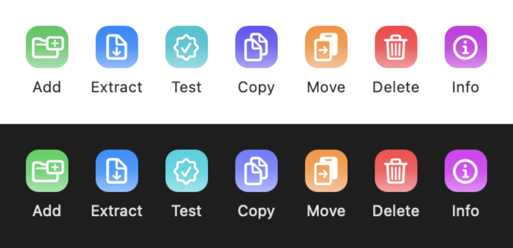

<!--
SPDX-FileCopyrightText: 2026 Rajesh D'Monte
SPDX-License-Identifier: Apache-2.0
-->

<div align="center">

# ArcSeven

**A native macOS reimplementation of the Windows 7-Zip File Manager.**

Written from scratch in Swift 6 and AppKit. Universal, notarised, and free software.

[](LICENSE)
[](https://github.com/havokentity/ArcSeven/releases/latest)
[](#requirements)
[](#requirements)
[](#tests)



</div>

---

> [!IMPORTANT]
> **This is not 7-Zip.** Not a port, not a fork, not an official build, not a rebranding.
> It is a clean-room reimplementation of 7zFM's *user interface* that drives the real,
> unmodified 7-Zip console binary as a subprocess. It is not affiliated with, endorsed by,
> or sponsored by the 7-Zip project or Igor Pavlov. See [Trademarks](#trademarks).

## Install

Download the latest `.dmg` from [**Releases**](https://github.com/havokentity/ArcSeven/releases/latest),
drag ArcSeven to Applications, and open it. The build is signed with a Developer ID,
notarised and stapled, so Gatekeeper accepts it without any right-click dance.

ArcSeven updates itself from **0.1.3 onwards**. Earlier builds shipped without a working
updater and have to be replaced by hand once.

> [!WARNING]
> **Early software.** The core paths — browse, extract, add, test, delete — are covered by
> tests that drive the real `7zz` against real archives. It has not been through a wide beta.
> Keep backups of anything irreplaceable.

## What it does

| | |
|---|---|
| **Browse** | The filesystem, and the inside of an archive, in the same window. One or two panels (`⌘2` — 7zFM uses F9, which is an fn-key hostage on Mac laptops). Directories inside archives are navigable to any depth. |
| **Extract** | With a destination picker, path modes, overwrite handling and a progress sheet. Exit code 1 is reported as *success with warnings*, never as failure. |
| **Create & add** | The full Add dialog — format, level, method, dictionary and word size, volumes, encryption with header encryption for `.7z`. Drag files onto a panel to insert them into the open archive. |
| **Test, Copy, Move, Delete** | Toolbar and menu, with the two-panel transfers 7zFM users expect. |
| **Drag out** | Members are promised, not extracted, until a drop actually completes. |
| **Finder** | Right-click context menu, per-format document icons, Quick Look previews, and Services. |
| **Encryption** | Password prompting on open, AES-256, and every encrypted archive it creates is re-listed afterwards to prove the encryption actually took. |
| **Sort** | 7zFM's order, not Finder's: `..` pinned first, folders above files in *both* directions, natural numeric names, deterministic tiebreak. |

### Not yet

Honest list, because a list of features is worth little without one.

- **Nested archives — browsing works, leaving does not.** `outer.7z/inner.tar/deep/leaf.txt`
  descends correctly, but the inner archive is staged to a temp file and the provider keeps
  no chain back to its parent, so `..` from a nested root drops you into
  `/var/folders/…` rather than back into `outer.7z`. Extract destinations and quarantine
  propagation are derived from the staged copy for the same reason. Treat nested browsing
  as one-way until that chain exists.
- **Opening a member.** No in-app viewer and no temp-file edit/write-back.
  `engine.readEntry(_:)` already streams a member's bytes; nothing calls it.
- **View modes.** Details only — no icon views, no flat view.
- **Rename, Create Folder, select-by-mask, in-place update, benchmark, checksums,
  split/combine, archive comment, SFX.**
- **Persistence.** `FavoritesStore`, `FolderHistoryStore` and `PanelPreferences` are
  implemented and tested, but no UI reads them, so column widths, sort and folder do not
  survive a relaunch.
- **Keymap presets.** Key equivalents are hard-coded; the Finder / Commander / Classic
  presets are not built.
- **Live decompression-bomb metering.** Extraction now *asks* before running when the
  archive declares an alarming expansion, but the figures come from the archive’s own
  header. Nothing meters the bytes as they are written, so an archive that lies about its
  sizes is not caught. See [`docs/SECURITY.md`](docs/SECURITY.md) §3.

## How it works

**ArcSeven bundles 7-Zip as a separate program.** It ships the console program `7zz` — built from
**unmodified upstream source** — as a separate executable at
`ArcSeven.app/Contents/Helpers/7zz`, and drives it over argv, stdin and stdout. No 7-Zip
code is linked, embedded, patched or copied into this repository.

The process boundary keeps ownership and licensing unambiguous: ArcSeven's first-party
code is Apache-2.0, while the unmodified `7zz` executable retains its upstream LGPL, BSD,
and unRAR terms. The RAR decoder's use restriction applies only to that upstream component.
It is never copied into or linked with ArcSeven, and ArcSeven never offers RAR creation.

**Vendoring.** `vendor/7zip` is a submodule pinned to [ip7z/7zip](https://github.com/ip7z/7zip)
**26.02** (`f9d78aff`). `vendor/build-7zz.sh` builds it with upstream's own makefiles — zero
patches — `lipo`s the slices into a universal binary, executes both, checksums the result
and writes a provenance stamp. It **refuses to build a modified tree** without a loud
override.

**Corrections found by driving the real binary**, recorded in
[`docs/ENGINE-PROTOCOL.md`](docs/ENGINE-PROTOCOL.md) Appendix A:

- A bare `-p` means an **empty** password and suppresses the prompt. It does not read stdin.
- Omitting **both** `-y` and `-p` makes `7zz` prompt and read the passphrase from stdin,
  no TTY required. Read operations use that path — and must therefore pass an explicit
  `-ao*`, or the *overwrite* prompt blocks on the same pipe the passphrase is going down.
- **`-mem=` is ZIP-only.** The `.7z` handler rejects it with `E_INVALIDARG`.
- **Creation has no prompt at all.** Piping a passphrase to `7zz a` silently produces an
  **unencrypted** archive and exits 0. Creation puts `-p<pw>` on argv, and every created
  archive is verified afterwards.

**Modules.** `ArchiveCore` (engine, parsers, models — no AppKit) · `FMKit` (file-manager
domain — no views) · `Support` (path normalisation, quarantine, trash, thread planning) ·
`FMUI` · `Dialogs` · `SettingsUI` · `App`.

Deeper reading: [architecture and the fidelity matrix](docs/ARCHITECTURE.md) ·
[deliberate departures from Windows](docs/DIVERGENCES.md) ·
[the `7zz` contract](docs/ENGINE-PROTOCOL.md) · [threat model](docs/SECURITY.md) ·
[release process](docs/RELEASING.md).

## Requirements

|  |  |
|---|---|
| **macOS (run)** | 14.0 Sonoma or later |
| **macOS (build)** | 15.0 or later, because Xcode 26 needs it |
| **Architecture** | Universal 2 — Apple Silicon and Intel |
| **Toolchain** | Xcode 26, Swift 6 strict concurrency, [XcodeGen](https://github.com/yonaskolb/XcodeGen), [SwiftLint](https://github.com/realm/SwiftLint) |

The Swift module and Xcode target are named `ArcSeven` — Swift module names cannot begin
with a digit. The bundle identifier root is `com.havokentity.ArcSeven`.

## Building

```bash
git clone --recurse-submodules https://github.com/havokentity/ArcSeven.git
cd ArcSeven
Scripts/bootstrap.sh
```

`bootstrap.sh` is idempotent: it checks the toolchain against the project minimums, pins and
configures the submodule, builds `7zz`, installs XcodeGen if missing — **asking first** —
generates the project, and prints next steps.

By hand:

```bash
./vendor/build-7zz.sh
xcodegen generate
xcodebuild -project ArcSeven.xcodeproj -scheme ArcSeven -configuration Debug build
```

`ArcSeven.xcodeproj` is generated and never committed. Re-run `xcodegen generate` after
touching `project.yml` or adding a file, and never patch the project by hand.

### Tests

```bash
swift test
```

261 tests across 30 suites, running from `Package.swift` — **no Xcode project, no signing,
no app bundle** — which is exactly what CI runs on every push.

Several suites are live: they build real archives with the vendored binary and drive them
end to end, including hostile ones that try to escape the destination directory. They carry
an `.enabled(if:)` trait that **skips when `vendor/bin/7zz` is missing**, so a bare checkout
still passes. Run `./vendor/build-7zz.sh` to include them, and re-run them on every upstream
bump — that is what they are for.

Before pushing:

```bash
Scripts/preflight.sh
```

Build, test, lint, both Xcode configurations, and a set of guards for things that have
silently broken before — an updater wired to nothing, Sparkle keys on the wrong target.

## Build systems: the `module-guard` idiom

**Read this before adding a file.** Two build systems disagree about module boundaries:
`Package.swift` builds **six** modules; the Xcode target compiles the same files into
**one**. Xcode cannot consume a local package rooted at the project's own directory, so the
app target compiles the sources directly. Pointing both at the same directories means there
is exactly one copy of every file, and `swift test` exercises precisely what the app ships.

Every intra-project import is therefore written as:

```swift
#if canImport(ArchiveCore)   // module-guard
import ArchiveCore
#endif
```

True under SwiftPM; false under Xcode, where the types are already in scope. Apply it to
`ArchiveCore`, `FMKit`, `FMUI`, `Dialogs`, `SettingsUI` and `Support` — **not** to `AppKit`,
`Foundation`, or anything else from the SDK. A file that imports a sibling module without it
fails the app target with "Unable to resolve module dependency".

## Licence

**ArcSeven is open-source software under the [Apache License 2.0](LICENSE)** — SPDX:
`Apache-2.0`. Copyright © 2026 Rajesh D'Monte.

> Distributed on an **AS IS** basis, without warranties or conditions of any kind. See the
> Apache License 2.0 for the complete terms.

Every first-party source file carries an SPDX identifier. The complete third-party
inventory is [`THIRD_PARTY_LICENSES/README.md`](THIRD_PARTY_LICENSES/README.md); the
obligations are in [`NOTICE`](NOTICE). Both ship inside the app at
`Contents/Resources/Legal/`, reachable from **Help ▸ Acknowledgements & Licences**, and in
the disk image, so nobody has to visit GitHub to read a licence.

### Bundled components

| | | |
|---|---|---|
| **7-Zip** `7zz` | LGPL-2.1-or-later, BSD-3-Clause, BSD-2-Clause, unRAR restriction | Separate process — **not linked** |
| **Sparkle** 2.9.6 | MIT | Linked framework |

As 7-Zip's `license.txt` requires of binary redistributors:

1. **This product uses parts of the 7-Zip program.**
2. **7-Zip is licensed under the GNU LGPL** (2.1 or later), with portions under BSD 3-clause
   and BSD 2-clause, and the unRAR restriction applying to RAR decompression.
3. **7-Zip source is available from <https://www.7-zip.org>.**

7-Zip Copyright © 1999–2025 Igor Pavlov.

**Source offer.** LGPL-2.1 §4 is satisfied by "equivalent access to copy the source from the
same place": the upstream source archive matching the `7zz` in each release
(`7zip-26.02-src.tar.xz`) is attached to the **same GitHub Release** as the `.dmg`. It is
mirrored here rather than merely linked, so the offer cannot rot. Version, both SHA-256
checksums and the upstream URL are in
[`THIRD_PARTY_LICENSES/7-Zip/VERSION.txt`](THIRD_PARTY_LICENSES/7-Zip/VERSION.txt), along
with the line that does the real work: `Modifications: NONE`.

## unRAR restriction

7-Zip's RAR decompression derives from unRAR, all copyrights to which are owned by Alexander
Roshal. Its licence carries a **use restriction**, quoted verbatim from
<https://www.7-zip.org/license.txt> because that licence requires the statement to appear in
the documentation of anything redistributing the code:

```
  The unRAR sources cannot be used to re-create the RAR compression algorithm,
  which is proprietary. Distribution of modified unRAR sources in separate form
  or as a part of other software is permitted, provided that it is clearly
  stated in the documentation and source comments that the code may
  not be used to develop a RAR (WinRAR) compatible archiver.
```

**RAR is extract-only in ArcSeven.** It reads RAR by invoking the bundled `7zz`; it cannot
create RAR and offers no affordance to. This is not a feature awaiting implementation — the
Windows 7-Zip File Manager cannot create RAR either, for the same reason.

Fedora's determination is blunter: the unRAR licence "has use-restrictions that make it
GPL-Incompatible and non-free." That is why the subprocess boundary is architecture rather
than preference. A future in-process engine will link a `7z.dylib` built **without** the RAR
handlers; `.rar` will route to the `7zz` subprocess forever.

## Trademarks

**ArcSeven is not affiliated with, endorsed by, or sponsored by the 7-Zip project or Igor
Pavlov.** "7-Zip" is used solely descriptively — to state compatibility and identify the
software whose behaviour is reimplemented — never possessively and never as an official
designation. ArcSeven ships no 7-Zip artwork, icon or trade dress, and it is not
"7-Zip for Mac".

Behaviour is specified by reading upstream resource scripts and sources at
[ip7z/7zip](https://github.com/ip7z/7zip), describing what they do, and reimplementing it.
No upstream code is copied into this repository. See
[CONTRIBUTING.md](CONTRIBUTING.md#clean-room-rule-non-negotiable).

"7-Zip", "WinRAR" and all other trademarks are the property of their respective owners.

## Distribution

ArcSeven currently ships as a Developer ID–signed, notarised, stapled DMG. The application
is deliberately unsandboxed because its two-pane file manager browses arbitrary folders,
mounted volumes, and network shares. Apache-2.0 permits an additional Mac App Store build,
but that build would first need a sandbox-aware file-access layer, security-scoped bookmarks,
and a sandbox-inheriting signature for the bundled `7zz` helper.

## Related projects

The field is not empty, and it would be dishonest to pretend otherwise. **If one of these
does what you need, use it.**

- **[ShichiZip](https://github.com/idawnlight/ShichiZip)** — LGPL-2.1, Swift and
  Objective-C++ over the upstream 7-Zip tree. **The closest existing thing to this project
  by a wide margin**, and the one to evaluate first. It already ships dual panes, shortcut
  presets, drag-out, Quick Look, Finder Quick Actions, a benchmark window, folder history,
  favourites, full codec control and in-place modification.
- **[Keka](https://www.keka.io/)** — the best-loved Mac archiver, and the reason most people
  do not need this app. **Not open source** — `aonez/Keka` is the website and issue tracker.
  Deliberately *not a file manager*: it cannot browse inside an archive at all. The model
  for macOS-native polish; not prior art for the file-manager half.
- **[The Unarchiver](https://theunarchiver.com/)** — proprietary since the 2017 MacPaw
  acquisition; only [XADMaster](https://github.com/MacPaw/XADMaster) and the `unar`/`lsar`
  tools remain LGPL-2.1. Unbeatable at *opening obscure formats*; cannot create archives.

Also worth naming: **[PeaZip](https://peazip.github.io/)** (LGPL-3.0, unsigned builds),
**[muCommander](https://www.mucommander.com/)** (GPL, JVM, true F5/F6),
**[Double Commander](https://doublecmd.sourceforge.io/)** (GPL-2.0, Lazarus), and the
commercial natives **BetterZip**, **Commander One**, **ForkLift** and **Archiver**.

## Contributing

Read [CONTRIBUTING.md](CONTRIBUTING.md) first — in particular the clean-room rule, which is
not boilerplate, and the [`module-guard`](#build-systems-the-module-guard-idiom) requirement,
which will break your build if you skip it.

Contributions are accepted under `Apache-2.0`, with a DCO sign-off and no CLA. Bug reports
and fidelity discrepancies against Windows 7zFM are especially welcome.
